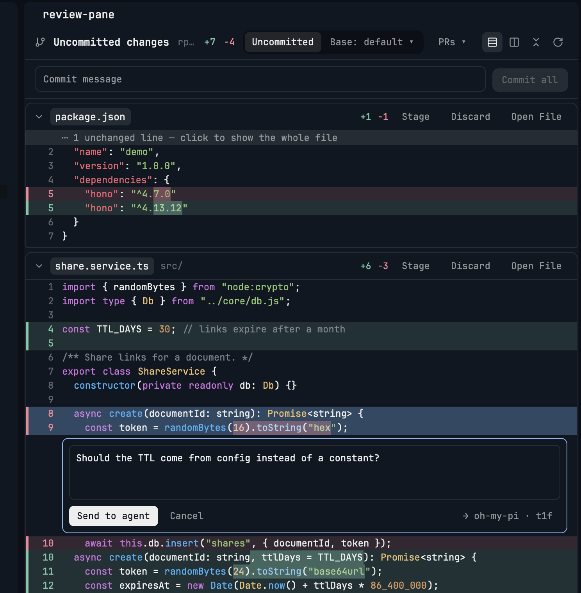

# Review pane for Herdr

A [Herdr](https://herdr.dev) mod: a code-review pane that splits in beside your terminal. Every changed file stacked in one scrolling view (unified or split, syntax colors, changed words marked), comments on lines sent straight to the agent in your space, and pull-request reviews in their own worktree and tab: GitHub's threads on their lines, reply, resolve, pending comments, and Comment / Approve / Request changes.

## Install

Tell your Herdr agent:

> Add the mod herdr.dev/mods/nichstoneking/herdr-review-pane

or point it at this repo. It copies `mods/review-pane` and `mods/review-pane-button` into `~/.config/herdr-app/mods/`, puts the button in a bar of your layout, and adds `cmd-shift-g` from `keys.json` (asking first if you use that key).

`RECIPE.md` is the full brief: what it looks like, how it behaves, and how it's built.

## Needs

- `git` on the machine the repo is on.
- For pull requests, GitHub's [`gh`](https://cli.github.com) signed in there.

## What it runs

It runs `git`, `gh`, `sh` and `awk` in your repos (on other machines through Herdr), writes a worktree per reviewed PR under `~/.herdr/worktrees` (or your `worktrees.directory`), and types into your agents' terminals only when you press **Send to agent**. Reviews, replies and resolves go to GitHub only when you press their buttons.

## Credits

The diff list, colors and base-branch guess started from [herdr-gitview](https://github.com/ChmaraX/herdr-gitview) by Adam Chmara (MIT). Icons from [Lucide](https://lucide.dev). MIT licensed; see `LICENSE`.
