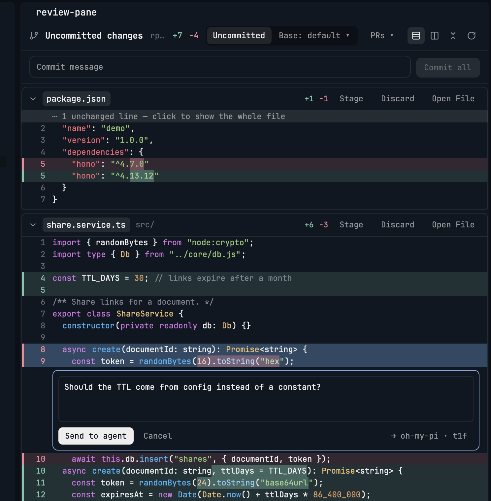

# Review pane

A code-review pane that splits in beside your terminal: every changed file of the repo stacked in one scrolling view, like Zed's `git: diff`, with syntax colors and changed words marked. Click line numbers to write about those lines and send it, with the code, to the agent in your space. Pick a pull request and it opens in a worktree of its own, in a new tab with a reviewer agent, where you can read and answer GitHub's review threads, resolve them, add review comments and submit the review.

## What you see

The pane opens to the right of the focused pane (a normal split, so it gets the layout's pane header), on the repo that pane's folder is in, on that pane's machine.

- **Top bar** (44 px, a 1 px bottom border): a branch icon; the title in semibold 13 px: "Uncommitted changes", "Changes since <base>", or "PR #<n>" in a PR's tab; then dim 12 px text, truncated: `repo · branch` (` · machine` on another machine), or in a PR `title · @author · base ← head`; the totals `+N` (ansi2) and `−N` (ansi1). Then, outside a PR, a two-button switch on the chrome color: **Uncommitted** and **Base: <branch> ▾**; in a PR, a **Review (N) ▾** button instead. Then **PRs ▾**, and four 26 px icon buttons: unified, split, expand/collapse all (one toggle: collapse icon while any file is open, expand icon when all are closed), refresh.
- **Commit row** (Uncommitted only, when there are changes): a one-line message box that grows to 6 lines, and a **Commit staged** / **Commit all** button (solid when there's text).
- **Files**, 5 px apart and 5 px below the bar, each a card with 8 px corners:
  - Header (36 px, surface color): a chevron, the file name in a 12.5 px semibold chip (green for new files, red and struck through for deleted, `blocked` for conflicted), the folder in dim 12 px, "N comments" (accent) when it has review threads, "staged", "new", `+N` / `−N`, and in Uncommitted **Stage**/**Unstage** and **Discard** (a second click within 4 s, "Really discard?", does it), then **Open File**.
  - Files start collapsed. Open, each line is an 18 px row in the mono font at 12 px: a 3 px marker (ansi2 for additions, ansi1 for deletions), the line number right-aligned in a 46 px column, then the code. Added rows are tinted ansi2 at 15 %, deleted ansi1 at 15 %, and the part of a changed line that differs from its pair at 36 %. Unchanged stretches fold into "⋯ N unchanged lines — click to show the whole file" rows.
  - Split view puts deletions left and additions right, with a 1 px divider.
- **Comment box** (130 px, accent border) under the selected lines: a 3-line text box, then **Send to agent** and (in a PR) **Add review comment**, **Cancel**, and on the right "→ <agent> · <address>".
- **Threads** (in a PR): cards under their line, indented past the line numbers. A title row (a "GitHub" or "Pending review comment" badge, "line N" or "lines A–B", "outdated", "resolved"), then each comment: the author in 11 px semibold ansi2, the text in 12 px on 17 px lines. Pending comments have an accent border. Resolved GitHub threads fold to one 28 px line: "✓ Resolved · line N · @who: first words".

## How it behaves

- The button (or its key) opens the pane beside the focused pane, or closes it if the shown tab has one; it's lit while open. Each tab has its own.
- **Uncommitted** shows staged and unstaged files as separate entries (untracked files with the unstaged). **Base** shows the working tree against the merge-base with a branch: by default the branch this one was cut from (the ref with the fewest commits to HEAD; trunks win ties), or one picked from the **Base ▾** list (the 200 most recent branches, right-aligned under the button).
- It refreshes at once when files change (this computer), and every 4 s (5 s on another machine); it loads the diffs near the view, four at a time.
- **Comments**: press a line number to select it, drag over others, shift-press to stretch the open box's selection. **Send to agent** types into the chosen agent's terminal (and presses enter): the file and lines, the diff of the selected lines, your text, and one line of instructions. Locally: "If that asks for a change, make it in the working tree (don't commit); if it's a question, just answer." In a PR: "This is someone else's pull request: answer only. Never edit files, commit or push." Nothing stays on the diff. The agent is the first one in the pane's space working in the repo, else the space's first; click the name to go to the next. With none, a warning toast.
- **PRs ▾** lists the open PRs, the ones requesting your review first ("review requested"), then by last update. Picking one fetches it, checks it out detached in a worktree (`<worktrees.directory>/<repo>/pr-<n>`, default `~/.herdr/worktrees`), writes `<git dir>/herdr-review/pr.json`, and opens a "PR #n" tab in the space: the same kind of agent as the one in your space (else your most-picked), with no first message, and the pane on the right in PR mode. Picking it again goes to that tab.
- **In a PR**: the base is `origin/<base>`. GitHub's review threads load (every 30 s, and after each change). **Reply** opens the box under a thread with **Reply on GitHub** (posts at once) and **Send to agent** (the thread's conversation is included). **Resolve** / **Unresolve** act on GitHub; a resolved thread folds and opens on click. **Add review comment** keeps a pending comment on the selected lines; **Review ▾** has a summary box and **Comment**, **Approve**, **Request changes**, which post the review with the pending comments. On your own PR only **Comment** shows ("It's your own PR: GitHub only lets you comment."). GitHub's own error text shows when it refuses.
- **Open File** opens your editor (`$VISUAL`, `$EDITOR`, else nvim, vim, vi, hx, nano, emacs) in a pane to the right, at the file's first change.

## Built from

- `mods/review-pane/` (`"focusable": true`): the pane. Props `{cwd, on, space, pr?}`; `pr` is `{number, title, url, author, base, headRef, head, repo}`.
  - `engine.js`: all git work through `exec` (with `on` for other machines): `git status --porcelain=v2 -z --untracked-files=all --no-renames`, `diff --numstat`, `hash-object` (to notice edits), `merge-base`, `for-each-ref`, `rev-list --count`, `diff -U3` (`--no-index` for untracked) parsed into rows; `add -A`, `restore --staged`, `restore`, `clean -f`, `commit`; `awk` for line counts; the editor from the login shell; `hc(["send", address, text])`.
  - `highlight.js`: a line tokenizer by file extension (C-like, Python, hash-comment, JSON, YAML, CSS, HTML/XML, SQL, Lua, Markdown) with One Dark / One Light colors, carrying block comments and multi-line strings to the next line.
  - `github.js`: `gh` (also `/opt/homebrew/bin/gh`, `/usr/local/bin/gh`): `pr list`, `pr view`, `repo view`, `api user`, GraphQL `reviewThreads`, `addPullRequestReviewThreadReply`, `resolveReviewThread` / `unresolveReviewThread`, and `POST /repos/{repo}/pulls/{n}/reviews`. Review payloads go through `/bin/sh` and `base64 -d`.
  - `review.js`: selection to anchor (side, lines, snippet), re-anchoring, the agent message, the pending comments in the shared value `review-pane.comments`.
  - `threads.js`, `scroller.js` (its own virtual list: every item's height is known, text is wrapped by column count), `paint.js`, `zoom.js`, `icons/` (Lucide).
  - `herdr`: `exec`, `hc`, `watchFolder`, `shared` / `setShared`, `agents`, `panes`, `spaces`, `knownAgents`, `readTextFile`, `appHome`, `settings`, `theme`, `notify`, `nextCommand`, `props`; commands `pane.split`, `tab.new`, `tab.select`, `terminal.open`.
- `mods/review-pane-button/`: a 28 px icon button for a bar of your layout. Its block: `{ "id": "review-pane-button", "type": "block", "size": { "px": 34 }, "content": { "mod": "review-pane-button" } }`, next to the bar's other buttons. Command `review-pane-button.toggle`.
- `keys.json`: `cmd-shift-g` → `review-pane-button.toggle`.
- Commands of the pane (for keys and scripts), `review-pane.<command>`: `scope:worktree|branch`, `base:<branch>|default`, `pick-base`, `view:split|unified`, `collapse`, `expand`, `toggle-all`, `refresh`, `select:<path>:<row>:<row>`, `draft:<text>`, `send:agent|comment|reply`, `reply:<thread id>`, `resolve:<thread id>`, `delete:<id>`, `prs`, `pr:<number>`, `review`, `review:COMMENT|APPROVE|REQUEST_CHANGES[:
]`.

## Watch out

- The button must sit in a block that's always shown: commands only reach visible mods, and the pane itself can't open itself.
- The list is virtual: every row needs a fixed height. Thread heights come from wrapping the text by column count (mono font, 7.2 px a column at 12 px); a proportional font breaks that.
- `gh api` puts GitHub's error in stdout, its stderr only says "Unprocessable Entity (HTTP 422)". `--slurp` doesn't exist in older `gh` (2.45 on Ubuntu); the threads come from GraphQL instead.
- GitHub refuses approving or requesting changes on your own PR; comments on lines far from a change ("show the whole file") may be refused too.
- The agent message is sent with `hc send`, which presses enter: it goes straight to the agent.
- Up to 100 review threads per PR and 100 comments per thread are read; diffs are cut at 6000 rows; untracked files past 400 aren't counted.
- Needs `git`; PRs need `gh` signed in, on the machine the repo is on. Claude Code asks once whether to trust each new worktree folder.
- Finished reviews keep their worktree and tab; remove them yourself.

## Done when

- The button opens the pane beside the focused terminal on its repo, and closes it.
- Uncommitted lists staged, unstaged and untracked files with counts; Stage, Unstage, Discard and Commit change the repo.
- Base shows the branch's changes against the guessed base; picking a branch changes it.
- Opening a file shows colored code, changed words marked, and folds that expand.
- Selecting lines and **Send to agent** puts the lines and the text in the agent's terminal.
- **PRs ▾** → a PR opens a "PR #n" tab with an agent and the pane in PR mode; GitHub's threads show on their lines; Reply posts on GitHub; Resolve folds the thread.
- A pending comment plus **Review → Comment** posts a review with that comment.
